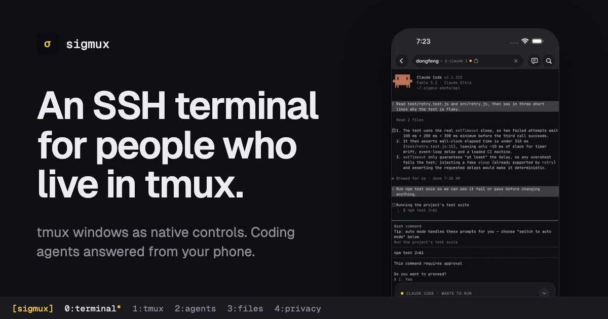

# Sigmux

An SSH terminal for iPhone and iPad, built around tmux and the coding agents you run on your own machines.

- **tmux, natively.** Sigmux speaks tmux control mode, so windows and panes are controls you tap: switch, split, rename, close. Classic `tmux attach` and plain shells work too.
- **Agents reach your phone.** Claude Code, Codex and OpenCode notify you when they finish or need an approval. Answer from the notification, or from a card over the pane that waits.
- **Read and write properly.** Reader shows an agent's conversation as text. Compose is a real text field with dictation, photos and files.
- **Your servers, your traffic.** No account, no analytics. Plain SSH from the phone to your machines; nothing to install for the terminal.

Free to try for 14 days, then a one-time purchase. No subscription.

**[Download on the App Store](https://apps.apple.com/app/sigmux/id6769982547)** · [sigmux.acmore.dev](https://sigmux.acmore.dev/)



## Help

- [Help](https://sigmux.acmore.dev/help.html): setup, tmux, Tailscale, agents, troubleshooting
- [Use Claude Code from your iPhone](https://sigmux.acmore.dev/guides/claude-code-from-iphone.html)
- [SSH over Tailscale is slow on cellular](https://sigmux.acmore.dev/guides/tailscale-ssh-slow-on-cellular.html)

## Bugs and requests

[Open an issue](https://github.com/acmore/sigmux-site/issues/new/choose). Issues are public: send anything with host names, addresses or trace files to sigmux@acmore.dev instead. Questions and ideas are welcome in [Discussions](https://github.com/acmore/sigmux-site/discussions).

## In this repository

- The website at [sigmux.acmore.dev](https://sigmux.acmore.dev/) (`index.html`, `help.html`, `privacy.html`, `guides/`)
- [`skills/sigmux`](skills/sigmux): an optional skill for Claude Code, Codex and OpenCode that helps an agent write updates and questions that read well on a phone:

  ```
  npx skills add acmore/sigmux-site --skill sigmux -g -a claude-code -a codex -a opencode -y
  ```

The app itself is closed source.
